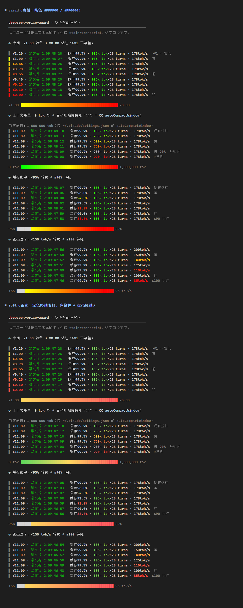

[English](README.md) · [简体中文](README.zh-CN.md) · [日本語](README.ja.md) · [한국어](README.ko.md)

# claude-code-statusline · DeepSeek 価格ガード & ステータスライン

**Claude Code + DeepSeek** 向けのガードツールです。DeepSeek のピーク価格時間帯におけるハードブロック、残高・使用量のステータスライン、そして Windows でステータスラインを**高速かつ安定**に動かすためのエンジニアリング記録をまとめています。

> 非公式プラグインであり、DeepSeek とは無関係です。残高の取得には公開エンドポイント `GET https://api.deepseek.com/user/balance` のみを使用します。



（上の画像は `scripts/demo-statusline.py` が**実際のスクリプト + 偽の stdin** で描画したもので、2 種類のパレットを比較しています）

---

## 機能

### 1. ピーク価格のハードゲート（PreToolUse フック）

DeepSeek は平日 **09:00–12:00 / 14:00–18:00**（北京時間、中国の法定祝日を除く）に価格が 2 倍になります。この時間帯、本プラグインは**すべてのツール呼び出し**をブロックします：

- WPF ダイアログ（システムのライト/ダークテーマに追従）で確認します：メッセージの下のドロップダウンで許可時間を選び（既定は **今回のみ許可**、ほかに 1 / 3 / 5 / 10 / 20 / 30 / 60 分と **今回のピーク時間帯を許可**）、「はい」を押します。「いいえ」または 30 秒無応答で拒否。アイコンは同梱の `assets/claude-light.ico`（黒・ライト用）/ `claude-dark.ico`（白・ダーク用）です。
- 拒否メッセージは**モデル向け**に書かれています：現在時刻とそのまま使える cron 式が含まれ、モデルは `CronCreate` で残りの作業を次のアイドル時間帯に予約し、きれいに終了します。
- スケジューリング系ツール（`CronCreate` / `CronList` / `CronDelete` / `ScheduleWakeup`）は**常に許可**されます。そうでなければモデルは予約自体できません。
- **スケジュールタスクが起動したターンはターン全体が免除**されます：フックは transcript から判別します（`turnOrigin: "scheduled"` / `scheduledTaskId`、かつ `promptId` がフックの `prompt_id` と一致）。無効化するには `"exempt_scheduled": false`。
- 中国の法定祝日は [timor.tech](https://timor.tech/api/holiday) から自動取得します（`scripts/fetch-holidays.py`、週次スケジュールタスクに登録）。取得できない場合は内蔵の 2026 年表を使用。
- セッション開始時に `DSPG_BYPASS=1` を設定すると、ガードを完全に迂回できます。
- 診断：判定は毎回 `~/.claude/.dspg_hook.log` に追記されます。直近のフック生ペイロードは `~/.claude/.dspg_hook_payload.json`（履歴は `.dspg_hook_payloads.jsonl`、`tool_input` を含むためプライバシーに注意）。

### 2. ステータスライン

```
deepseek-flash[1m] · ¥22.39 · valley 2:08:03:09 · cache 99.6% · 310k toks×8 turns · 451tok/s · cost ¥0.42
```

| セグメント | 意味 |
|---|---|
| `deepseek-flash[1m]` | 現在のモデル名（Opus / Sonnet などの高価格帯は赤 + `◆`） |
| `¥22.39` | アカウント残高（**描画パスは一切ネットワークに触れません** — 後述） |
| `valley 2:08:03:09` / `peak 01:00:00` | ピーク/アイドルのカウントダウン、**日:時:分:秒**（24 時間以上でのみ「日」を表示）。`valley` = アイドル（緑）、`peak` = ピーク（橙）。中国語 UI では 梁文谷 / 梁文峰。**ピーク価格があるプロバイダー（現在は DeepSeek のみ）でのみ表示** |
| `cache 99.6%` | セッション全体のキャッシュヒット率 |
| `310k toks×8 turns` | 現在のコンテキスト × この区間の API 呼び出し回数（`/compact` でリセット） |
| `451tok/s` | 平均出力速度（API 所要時間で算出。ツール実行や入力待ちは含まない） |
| `cost ¥0.42` | 価格表から推定したセッションコスト（現在のモデルの価格が分かる場合のみ表示） |

**配色**：値は警告域に入ったときだけ色が付き、通常は素のままです。異常が一目で分かります。

| 指標 | 色なし | 黄 | グラデーション | 赤 |
|---|---|---|---|---|
| 残高 | > ¥1 | ¥1.00 | ¥1 → ¥0 | ¥0 |
| キャッシュヒット | ≥ 95% | < 95% | 95% → 90% | ≤ 90% |
| 出力速度 | ≥ 150 tok/s | < 150 | 150 → 100 | ≤ 100 tok/s |
| コンテキスト | — | 50% | 0 緑 → 100% 赤 | 自動圧縮のしきい値 |

- コンテキストのグラデーションの分母は Claude Code の `autoCompactWindow`（`~/.claude/settings.json`）から読み取るため、「自動圧縮までどれくらいか」が色で分かります。フォールバックは `CLAUDE_CODE_MAX_CONTEXT_TOKENS`、次に 1M。
- **点滅**：指標が**警告域に入った直後**、そのセグメントが反転表示で 3 回点滅します（警告色を背景、白文字）。その後は静かに色が付いたままです。判定は**表示値**（残高はセント単位、キャッシュは 0.1%、速度は整数）で行うため、表示が変わらないのに再点滅することはありません。
- **モデルのテーマカラー**：モデル名を各社の**主要ブランドカラーの単色**で表示します。`.dspg_config.json` の `"model_theme": false` で無効化できます（settings コマンドでも確認されます）。
- 24 ビットトゥルーカラー、非対応端末では 256 色にフォールバック。`DSPG_TRUECOLOR=0/1` で強制できます。
- `/balance` コマンド：残高・料金帯・残り時間・ヒット率をモデルに報告させます。

### 3. 主要プロバイダー対応

使用中のプロバイダーに合わせて、ステータスライン・残高・ガードが自動で切り替わります：

| プロバイダー | 識別 | 残高 | ピーク価格ガード | コスト推定 |
|---|---|---|---|---|
| **DeepSeek** | `deepseek*` | `/user/balance`（CNY） | ✅ | ✅ 内蔵価格表（ピーク/オフピーク） |
| **Moonshot / Kimi** | `kimi*`, `moonshot*` | `/v1/users/me/balance`（CNY） | — | 価格表に追加 |
| **Anthropic Claude** | `claude*`, `opus/sonnet/haiku` | Admin key のみ → n/a | — | 価格表に追加 |
| **OpenAI** | `gpt*`, `o1/o3/o4` | Admin key のみ → n/a | — | 価格表に追加 |
| **Google Gemini** | `gemini*`, `gemma*` | n/a | — | 価格表に追加 |
| **GLM（智谱）** | `glm*` | n/a | — | 価格表に追加 |
| **Xiaomi MiMo** | `mimo*`, `xiaomi*` | n/a | — | 価格表に追加 |

- 識別順：モデル名 → `ANTHROPIC_BASE_URL` → transcript の最後の assistant モデル。`~/.claude/.dspg_config.json` の `"provider"` で強制指定できます（既定 `auto`）。
- **ピーク価格のブロックは DeepSeek のみ**。Kimi / Claude / Gemini / GLM などではブロックもカウントダウン表示も行いません。
- 残高はプロバイダーの通貨で表示。公開残高 API がない場合は `bal N/A` と表示し、他のセグメントは通常どおり動きます。

**価格表**：内蔵は DeepSeek のみ（2026-10-22 に公式価格ページから取得、CNY / 100万 tokens、ピーク = オフピークの 2 倍）。それ以外は `~/.claude/.dspg_prices.json` に追加します：

```json
{
  "moonshot": {
    "kimi-k3": {"input": 4.0, "cache_read": 1.0, "output": 16.0, "currency": "CNY"},
    "default": "kimi-k3"
  },
  "anthropic": {
    "claude-opus-5-5": {"input": 15.0, "cache_read": 1.5, "output": 75.0, "currency": "USD"}
  }
}
```

単位は 100万 tokens、通貨はプロバイダーに従います。任意の `peak_multiplier` はピーク時間帯に適用されます。コストはセッション累計の input / cache_read / output に**現在の時間帯**の単価を掛けて推定します。

### 4. バックグラウンドでの残高更新（描画パスはネットワークなし）

ステータスラインは毎秒（または数秒ごと）に 1 フレーム描画します。描画パスでネットワークリクエストを行うと、通信が乱れた瞬間にフレームが間に合わなくなります。Claude Code はそれを**キャンセルし、`taskkill` でプロセスツリーを強制終了**します。これが数回起きるとゾンビプロセスの雪崩になります（後述のエンジニアリングノート参照）。

そこで：**描画パスはローカルキャッシュだけを読みます**（`~/.claude/.balance_cache.json`、30 秒有効）。期限切れのときは**切り離された**バックグラウンドプロセスが更新します。描画コストは一定です（実測 180–225 ms → shim 経由で 131 ms）。

### 4. オプション：常駐デーモン + ネイティブ shim（Windows で 3 倍高速）

Claude Code はステータスラインを更新するたびに、`Git Bash（103 ms）→ python（74 ms）→ スクリプト` という一連のチェーンを起動し、それぞれにコンソールホスト `conhost` が付きます。

本プラグインにはオプションの **C 製 shim + Python 常駐デーモン** が付属します：

```
CC → bash（CC が強制、回避不可）→ dspg-status.exe（~15 ms）→ 127.0.0.1:18799 のデーモン（プロセス内で描画）
```

| | 旧パス（bash+python） | shim + デーモン |
|---|---|---|
| 1 フレーム | 421 ms | **131 ms** |
| プロセス数/フレーム | bash + python + 2×conhost | ネイティブ exe 1 個 |

3 段階のフォールバック：

1. デーモンがいない場合、shim はデーモンが最後に書いた行（`~/.claude/.dspg_line.txt`）を出力します — **空白にはなりません**。
2. shim がデーモンを起動します（`pythonw`、ウィンドウなし）。次のフレームで復帰します。
3. デーモン内蔵のウォッチドッグ（10 秒ごと）：**ハングした `taskkill` が 60 個を超えたら自動回収**（それらが独占する `conhost` も終了）。これは Claude Code の「キャンセル時に `taskkill /T` でプロセスツリーを消す」副作用の自動抑制です。回収後も 2 回連続で 100 個を超えた場合にのみ、`refreshInterval` を 5 秒に戻す緊急ブレーキを作動させます。

導入手順は [`scripts/dspg-status.c`](plugins/claude-code-statusline/scripts/dspg-status.c) の先頭コメントを参照してください。`dspg.env`（exe と同じディレクトリ、gitignore 済み）で `PYTHONW=<絶対パス>` を指定できます。

---

## インストール

```bash
# Claude Code 内で
/plugin marketplace add <あなたの GitHub アカウント>/claude-code-statusline
/plugin install claude-code-statusline@claude-code-statusline
```

前提条件：

- Python 3.8+（`python` が PATH にあること。`python3` しかない環境では `hooks/hooks.json` の `python` を `python3` に変更）
- ステータスラインは `~/.claude/settings.json` で設定する必要があります（プラグインは settings を自動変更しません）：

```json
{
  "statusLine": {
    "type": "command",
    "command": "python \"C:/Users/<あなた>/.claude/plugins/marketplaces/claude-code-statusline/plugins/claude-code-statusline/scripts/deepseek-status.py\"",
    "refreshInterval": 5
  }
}
```

（`refreshInterval` の最小値は 1 秒です。**`0.5` を書くとクランプされず、ステータスラインの更新が完全に止まります**。）

- 残高 API には API キーが必要です：環境変数 `DEEPSEEK_API_KEY`、または `~/.claude/settings.json` の `env.ANTHROPIC_AUTH_TOKEN`（公式 DeepSeek エンドポイント利用時は通常すでに入っています）。

---

## 設定

Claude Code 内蔵の `/config` はプラグインによる項目追加を許可していないため、専用コマンドを使います：

```
/claude-code-statusline:settings
```

4 つの質問に答えると、以下のファイルに書き込まれます：

| 設定 | 保存先 | 説明 |
|---|---|---|
| 更新間隔（秒） | `~/.claude/settings.json` → `statusLine.refreshInterval` | 1 / 2 / 5 / 15 秒、**最小 1 秒** |
| 言語 | `~/.claude/.dspg_config.json` → `language` | `auto`（システムの表示言語に従う）/ `en` / `zh`。UI 文言は現在 英語・中国語に対応し、それ以外は英語にフォールバック |
| モデルのテーマカラー | `~/.claude/.dspg_config.json` → `model_theme` | `true`（既定）：ブランドカラー / `false`：単色 |
| provider の強制指定 | `~/.claude/.dspg_config.json` → `provider` | `auto`（既定）または provider キー（`deepseek`、`moonshot`、`anthropic`、`openai`、`gemini`、`glm`、`xiaomi`） |
| 追加操作 | `~/.claude/.dspg_override.json` | 30 分間の一時許可 / 現在の許可を解除 |

## ステータスラインの調整項目

| 変更したいもの | 変更場所 |
|---|---|
| 警告しきい値 | `scripts/deepseek-status.py` 先頭の `BALANCE_YELLOW_AT` / `CACHE_WARN_PCT` / `RATE_WARN_TPS` / `CTX_ALERT_RATIO` |
| パレット | 先頭の `PALETTES`（`vivid` 彩度高め / `soft` 暗い端末向け）、または環境変数 `DSPG_PALETTE=soft` |
| 点滅回数 | `BLINK_FRAMES`（既定 6 フレーム = 3 回） |
| 残高キャッシュの有効期間 | `BALANCE_TTL`（既定 30 秒） |

---

## エンジニアリングノート：Windows における Claude Code ステータスラインの罠

すべて実測で踏んだものです。後から来る人のために：

1. **CC は必ず Git Bash 経由でステータスラインコマンドを起動します**（採取したプロセスツリー：`bash.exe -c "\"python.exe\" -X utf8 \"script.py\""`）。`bash -c true` だけで **103 ms** かかります。これは MSYS2 の POSIX エミュレーション層のコストです（Linux では 2 ms）。.NET/Go に変えてもこの層は消えません。「毎フレームプロセスを起動しない」ことだけが解決策です。
2. **ステータスラインの出力はプロセス終了後にしか表示されません**。しかも**新しい更新が進行中のものをキャンセルします**。つまり常駐プロセスが直接 print しても無意味（内容は永遠に表示されない）で、**描画が遅い = キャンセル = `taskkill`** です。
3. **1 秒更新の雪崩**：毎分数十回のプロセス生成。マシンが少し重くなる（コンパイル、ウイルススキャン、メモリ逼迫）だけで 1 フレームが間に合わなくなり → キャンセル → `taskkill` でツリー削除 → ハングした `taskkill` が積み上がる（実測 300 個以上、7.5 GB）→ メモリ逼迫 → さらに遅くなる。**根治策はネットワーク呼び出しとすべての遅い処理を描画パスから追い出すこと**であり、更新頻度を下げることではありません。
4. `refreshInterval` の単位は秒で**最小 1**。`0.5` はクランプされず、**ステータスラインが完全に停止**します（実測：14 秒で 0 フレーム）。
5. **Windows の `SO_REUSEADDR` は同一ポートの二重バインドを許可します**（Linux と逆）。「ポートが使われていたら終了」という単一インスタンス保護に使うと失敗し、デーモンが増殖します。`SO_EXCLUSIVEADDRUSE` を使いましょう。
6. **`-mwindows`（GUI サブシステム）では CRT の stdout が継承パイプに接続できません**。`printf` は黙って出力を捨てます。標準ハンドルに `ReadFile`/`WriteFile` を使うか、コンソールサブシステムのままにします（shim は bash 既存のコンソールに相乗りし、**conhost を増やしません**）。
7. transcript の増分集計では、1 回の API レスポンスが複数の assistant レコードに分割され（content block ごとに 1 件）、**どれも同じ完全な usage を持ちます**。単純に合計すると output が 3〜5 倍に膨らみます（実測 115,703 対 実際 37,302）。レコードは厳密に隣接しているので、区間の先頭だけを取ります。
8. **PreToolUse の「確認」は `hookSpecificOutput.permissionDecision` を使う必要があります**（トップレベルの `decision`/`reason` は非推奨）。`"ask"` は CC 自身の権限ダイアログを表示し、`permissionDecisionReason` がそこに表示されます。JSON を解析させるにはフックが **exit 0** で終わる必要があります（exit 2 は即ブロックで、JSON は一切無効）。
9. **PreToolUse フックはタイムアウトしても既定ではブロックしません**。フックをゲートとして使いたい場合（この価格ガードのように）は、`hooks.json` に `"onFailure": "block"` を書く必要があります。そうしないとフックがハング・タイムアウトしたときにツール呼び出しがそのまま通ります。
10. **フックのペイロードに「ターンの由来」を示すフィールドはありません**：スケジュールタスクによるターンかどうかを判断するには、`transcript_path` の jsonl を読み返す必要があります。注入された user メッセージには `turnOrigin: "scheduled"` / `scheduledTaskId` / `promptSource: "system"` が付き、その `promptId` はフックペイロードの `prompt_id` と一致します。罠が 2 つ：同じ `promptId` は**すべてのツール結果**の user レコードにも付いており（`turnOrigin` なし、逆順走査で先に当たる → `toolUseResult` を持つレコードをスキップ）、長いターンではトリガー行が末尾ウィンドウから押し出されます → 判定結果を `prompt_id` ごとに `.dspg_turn_cache.json` へキャッシュします。読むのは末尾 4 MB のみで、見つからなければ通常のターンとして扱います（フェイルクローズ）。

---

## ファイル構成

```
.claude-plugin/marketplace.json          # marketplace マニフェスト
plugins/claude-code-statusline/
├── .claude-plugin/plugin.json
├── commands/balance.md                  # /balance コマンド
├── commands/settings.md                 # /claude-code-statusline:settings コマンド
├── hooks/                               # PreToolUse ピークゲート
├── scripts/
│   ├── deepseek-status.py               # ステータスライン（配色/点滅/カウントダウン/非同期残高）
│   ├── providers.py                     # provider 識別 / 残高 API / 価格表
│   ├── i18n.py                          # UI 文言（英語/中国語、システム言語に従う）
│   ├── demo-statusline.py               # デモ描画（ターミナルで直接実行）
│   ├── statusd.py                       # オプション：常駐デーモン
│   ├── dspg-status.c                    # オプション：ネイティブ shim のソース（build.cmd）
│   ├── fetch-holidays.py                # 中国の法定祝日取得
│   ├── ds-count.py                      # ローカル tokenizer によるカウント
│   └── price-watch.py                   # 価格ページのフィンガープリント自己検査
├── demo-shot.png
├── README.md / README.zh-CN.md / README.ja.md / README.ko.md
```

## License

MIT
